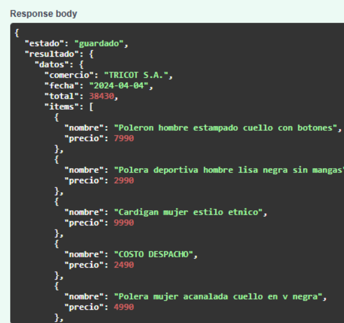

# Estimador de Recibos con IA

API que recibe la foto de un recibo, usa Gemini para extraer los datos en formato JSON, los valida y los guarda en SQLite.


## Cómo correrlo

1. Instala las librerías:

```
pip install -r requirements.txt
```

2. Crea un archivo `.env` en la raíz del proyecto con tu propia clave de Gemini:

```
GEMINI_API_KEY=tu_clave_aqui
```

3. Levanta el servidor desde la raíz del proyecto:

```
uvicorn main:app --reload --app-dir app
```

4. Abre http://127.0.0.1:8000/docs y prueba `POST /subir` con la foto de un recibo.


## Tecnologías

- Python
- FastAPI
- SQLite
- Gemini API


## Captura



## Rutas

- `POST /subir`: recibe la foto de un recibo, extrae los datos con Gemini, los valida y los guarda en SQLite. Si el recibo ya existe, no lo vuelve a guardar.
- `GET /buscar?___=tricot`: devuelve los recibos guardados cuyo comercio contiene el texto buscado.